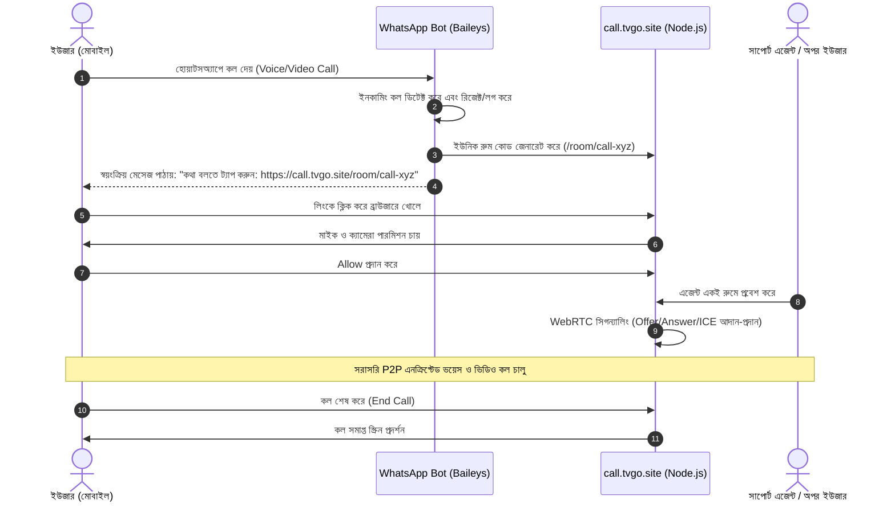
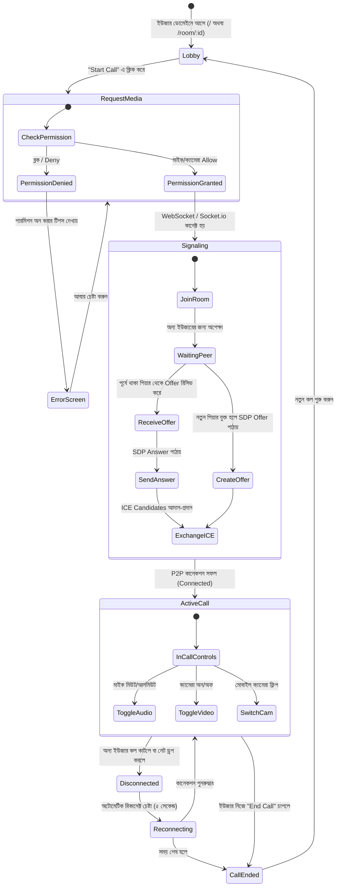
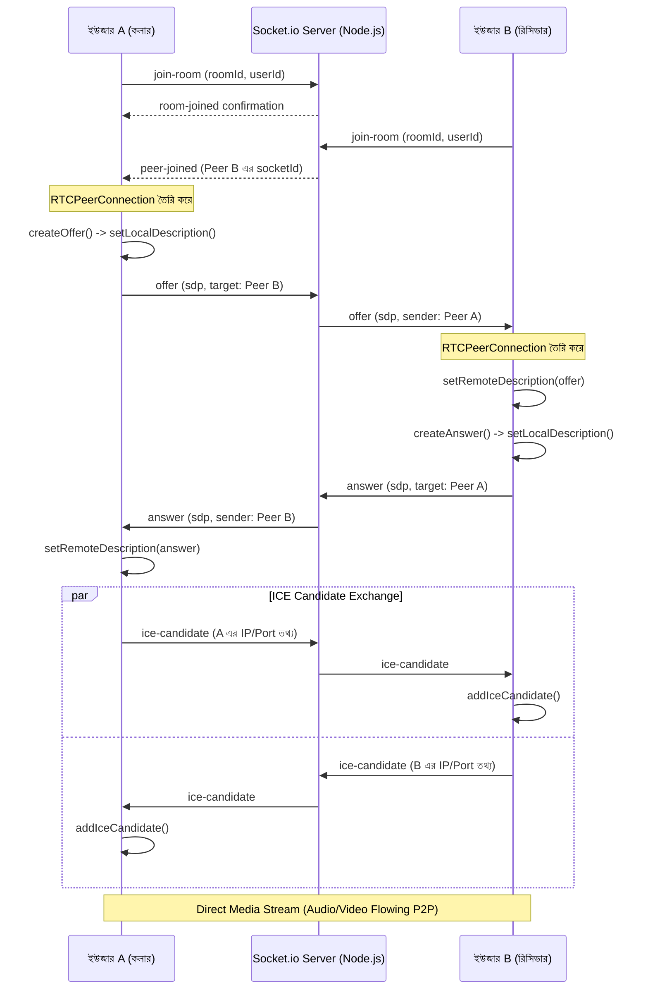

# Application Flow & Architecture (AppFlow)

* **ডোমেইন:** `call.tvgo.site`
* **পাথ:** `/www/wwwroot/call.tvgo.site`

---

## ১. এন্ড-টু-এন্ড ইউজার জার্নি (End-to-End User Journey)

---

## ২. ওয়েব অ্যাপ্লিকেশন স্টেট ট্রানজিশন (State Transitions)

---

## ৩. WebRTC সিগন্যালিং হ্যান্ডশেক বিস্তারিত (Signaling Flow)

