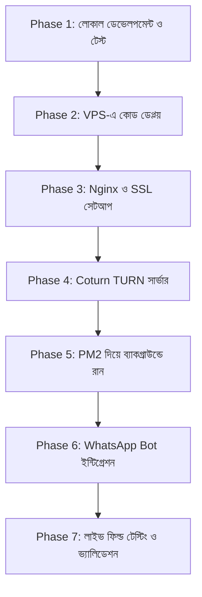

# Implementation & Deployment Plan (Plan)

* **ডোমেইন:** `call.tvgo.site`
* **পাথ:** `/www/wwwroot/call.tvgo.site`

---

## ১. ধাপে ধাপে রোডম্যাপ ওভারভিউ (Roadmap Summary)



---

## ২. বিস্তারিত ফেজ অনুযায়ী পরিকল্পনা (Detailed Phases)

### ফেজ ১: লোকাল ডেভেলপমেন্ট ও ফাংশনালিটি ভ্যালিডেশন
* **টাস্ক ১.১:** `c:\xampp\htdocs\call` ফোল্ডারে সম্পূর্ণ কোডবেস সম্পন্ন করা।
* **টাস্ক ১.২:** `server.js` লোকালহোস্টে চালু করে (`http://localhost:3000`) একই পিসির দুটি পৃথক ট্যাবে বা একই ওয়াইফাই নেটওয়ার্কের দুটি ডিভাইসে ভিডিও ও ভয়েস কল টেস্ট করা।
* **টাস্ক ১.৩:** মাইক মিউট, ক্যামেরা টগল, ক্যামেরা ফ্লিপ এবং কল ডিসকানেক্টের প্রতিটি বাটনের রেসপন্স ভ্যালিডেট করা।

---

### ফেজ ২: VPS-এ প্রজেক্ট আপলোড ও ডিপ্লয়মেন্ট
* **টাস্ক ২.১:** VPS-এর নির্দিষ্ট ডিরেক্টরি তৈরি করা:
  ```bash
  mkdir -p /www/wwwroot/call.tvgo.site
  cd /www/wwwroot/call.tvgo.site
  ```
* **টাস্ক ২.২:** লোকাল কোডসমূহ Git বা SFTP / SCP দিয়ে VPS-এ ট্রান্সফার করা।
* **টাস্ক ২.৩:** VPS-এ ডিপেন্ডেন্সি ইনস্টল করা:
  ```bash
  npm install --production
  ```

---

### ফেজ ৩: ডোমেইন ডিএনএস, Nginx এবং SSL কনফিগারেশন
* **টাস্ক ৩.১:** Cloudflare বা ডোমেইন প্রোভাইডারে গিয়ে `call.tvgo.site` এ-রেকর্ড (A Record) হিসেবে আপনার VPS আইপি পয়েন্ট করা।
* **টাস্ক ৩.২:** aaPanel অথবা Nginx কনফিগারেশন ফাইলে রিভার্স প্রক্সি কনফিগারেশনটি পেস্ট করা (WebSocket Upgrade ব্লক সহ)।
* **টাস্ক ৩.৩:** Certbot বা aaPanel এর মাধ্যমে ফ্রি Let's Encrypt SSL সার্টিফিকেট ইস্যু করা:
  ```bash
  certbot --nginx -d call.tvgo.site
  ```

---

### ফেজ ৪: Coturn (STUN/TURN) সার্ভার সেটআপ
* **টাস্ক ৪.১:** লিনাক্স প্যাকেজ ম্যানেজার দিয়ে Coturn ইনস্টল করা:
  ```bash
  sudo apt-get update && sudo apt-get install -y coturn
  ```
* **টাস্ক ৪.২:** `/etc/turnserver.conf` ফাইলে পোর্ট `3478` এবং ইউজার ক্রেডেনশিয়ালস সেট করা।
* **টাস্ক ৪.৩:** Coturn সার্ভিস স্টার্ট ও এনেবল করা:
  ```bash
  sudo systemctl restart coturn
  sudo systemctl enable coturn
  ```

---

### ফেজ ৫: PM2 দিয়ে স্থায়ীভাবে সার্ভার রান করানো
* **টাস্ক ৫.১:** গ্লোবাল PM2 ইনস্টল ও সার্ভিস স্টার্ট:
  ```bash
  npm install -g pm2
  cd /www/wwwroot/call.tvgo.site
  pm2 start server.js --name "call-app"
  ```
* **টাস্ক ৫.২:** সার্ভার রিবুট হলেও যাতে অটোমেটিক চালু হয়:
  ```bash
  pm2 startup
  pm2 save
  ```

---

### ফেজ ৬: WhatsApp Bot (Baileys) ইন্টিগ্রেশন
* **টাস্ক ৬.১:** আপনার চলমান হোয়াটসঅ্যাপ বটের মেইন ফাইলে `sock.ev.on('call', ...)` হুক যুক্ত করা।
* **টাস্ক ৬.২:** কল রিজেক্ট ও ইনস্ট্যান্ট এসএমএস সেন্ডিং টেস্ট করা।
* **টাস্ক ৬.৩:** প্রাপ্ত এসএমএসের লিংক মোবাইলে চাপ দিয়ে কল রুমে সফল প্রবেশ পরীক্ষা করা।

---

### ফেজ ৭: কোয়ালিটি অ্যাসিউরেন্স চেকলিস্ট (QA Checklist)
- [ ] ডোমেইন `https://call.tvgo.site` তে সিকিউরড লক প্যাডলক (SSL) সক্রিয় কিনা।
- [ ] অ্যান্ড্রয়েড ক্রোমে মাইক ও ক্যামেরা ঠিকমতো খোলে কিনা।
- [ ] আইওএস (iPhone Safari)-এ অডিও ও ভিডিও ঠিকমতো প্লে হয় কিনা।
- [ ] এয়ারটেল/জিও ৪জি ডেটা ব্যবহার করে ফায়ারওয়ালের পেছনে থাকা দুটি মোবাইলে ভয়েস ড্রপ ছাড়া কথা বলা যায় কিনা।
- [ ] কল শেষে লবিতে ফেরত আসার বিষয়টি স্মুথ কিনা।

